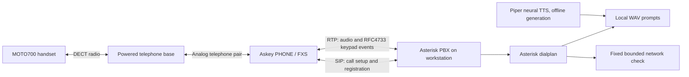

# How the private telephone lab works

Updated 2026-11-04. Evidence: [first private call](experiments/askey-voice-001.md) and [keypad/command menu](experiments/askey-voice-002.md). The owner subsequently confirmed that dialing **20 directly from the handset** reaches the menu.

## Implementation road

| Layer | Current result |
|---|---|
| Askey access and native code | Privileged vendor console, preserved flash capture and verified custom MIPS32 execution |
| Home LAN integration | Askey at 192.168.1.250, its DHCP service disabled |
| Telephone transport | MOTO700, Askey analog phone interface, private SIP registration, incoming ringing and bidirectional audio verified |
| Telephone interface | Direct dial 20, spoken menu, DTMF selection, fixed network check and hang-up verified |
| Menu usability | Prototype count/idle disconnects removed; local neural female prompts replace formant speech |
| Additional actions | Only the fixed Askey web-port connection check is implemented |
| Suzy/Sera realtime conversation | Future adapter work; their voices, agent state and tools are not connected yet |
| Private DSL copper link | Documented future experiment; no central-office peer or DSL trial established |

## PBX, process lifetime and startup

**PBX means Private Branch Exchange**: a private telephone exchange that handles extensions, call routing and call applications. The implementation here is **Asterisk**, a compiled program written primarily in C. It runs on the workstation, not inside the Askey.

Docker starts Asterisk with `asterisk -f -vv`: foreground inside the container. Docker runs that container in the background, independently of this terminal or coding-agent conversation. Closing the terminal does not stop it.

The container is `mero-askey-pbx`. At the owner's request its current policy is **`restart: unless-stopped`**, applied both in Compose and to the running container. Docker itself is enabled at host startup. The PBX will restart after a crash or reboot unless deliberately stopped. Docker does not accept `restart: "yes"`; that attempted setting was corrected to the supported policy. This was verified as configuration, not by rebooting the workstation. The service still depends on its configured host LAN address being available.

Only SIP UDP 5060 and RTP UDP 10000–10019 are published on 192.168.1.97. Administrative HTTP/manager interfaces are disabled. The phone endpoint ACL accepts the Askey. No public telephone provider or public internet port forwarding is needed for local calls.

## Signal and control paths



The Askey's existing voice firmware drives its analog circuitry, codecs and SIP client. Our previously demonstrated custom MIPS program is a separate capability; no custom router payload is required for this telephone path.

1. The Askey authenticates/registers phone identity `10` with the PBX.
2. Dialing `20` sends a call request; Asterisk routes it into `lab-menu`.
3. Asterisk plays a WAV prompt and waits for a keypad selection. Digits are received as telephone events, not recognized from speech by an AI model.
4. `1` plays an audio test; `2` checks the Askey web port; `9` repeats; `0` ends the call.
5. The result is spoken using another fixed WAV prompt. Regular menu calls are not recorded. The six-second recording was an explicit self-test.

The only command action runs **inside the PBX container**: a fixed Bash TCP connection attempt to `192.168.1.250:80`, bounded by `timeout 3`. It does not log into the Askey, execute a remote router command or test internet access. Keypad input never becomes shell text, a hostname or an executable argument.

## Source of truth and languages

| File | Language / role | Runs during calls? |
|---|---|---|
| `tools/prepare_telephony_pbx.py` | Python; generates Asterisk configuration and preserves private credentials | No, setup/update only |
| `.local/telephony-pbx/etc/extensions.conf` | Asterisk's own declarative dialplan; routing, prompts, key choices and fixed action | Yes, interpreted by Asterisk |
| `.local/telephony-pbx/etc/pjsip.conf` | INI-style SIP configuration; account, authentication, codecs and transport | Loaded by Asterisk |
| `tools/build_telephony_prompts.py` | Python; runs local TTS and FFmpeg, stages/install WAV prompts | No, prompt-generation time only |
| `lab/telephony/compose.yaml` | YAML; container, published ports, mounts and restart policy | Controls deployment |
| `lab/telephony/Dockerfile` | Image build instructions; packages and Asterisk startup command | Build/start time |
| `tools/inspect_telephony.py` | Python; read-only router voice audit/export | No |
| `tools/prepare_voice_trial.py`, `tools/apply_voice_trial.py` | Python; reviewed native router form proposal/application/rollback | No |
| `tools/check_telephony_pbx.py`, `tools/test_voice_form.py` | Python; isolated runtime check and form-order regression | No |
| `tools/collect_telephony_evidence.py` | Python; private snapshots and optionally the existing test recording | No; it does not initiate recording |

Edit the generator for durable dialplan changes, then regenerate and reload the dialplan. Editing generated `.local/` configuration alone can be overwritten by preparation. Passwords, models, sound assets, settings exports and recordings stay in ignored `.local/`.

## Voice generation

The first prompts used **eSpeak NG**, a classic formant TTS synthesizer; that produced the robotic sound. No LLM was involved.

The replacement uses **Piper 1.8.0**, a local neural TTS engine with the `en_US-lessac-medium` female narration model. Delivery uses length scale 1.12 and a short sentence pause for a calmer tone. The owner liked the initial voice preview. Generated speech is converted by FFmpeg to mono 8 kHz, 16-bit PCM WAV for the telephone path. The actual call plays saved files: there is no cloud request and no running TTS process for every keypress.

This is a stock lab narrator, not Suzy or Sera. “Mysterious” is a delivery preference, not an identity or capability of the model. The analog/G.711 telephone path is narrowband; a better model improves naturalness but does not turn the handset into a studio-bandwidth speaker.

Setup for reproducing the neural prompts:

```sh
rtk proxy uv venv --python 3.12 .local/telephony-tts-venv
rtk proxy uv pip install --python .local/telephony-tts-venv/bin/python -r lab/telephony/tts-requirements.txt
rtk proxy .local/telephony-tts-venv/bin/python -m piper.download_voices --data-dir .local/telephony-pbx/voices en_US-lessac-medium
rtk python3 tools/build_telephony_prompts.py
```

Generation refuses to replace prompts while a call is active. `--engine espeak` remains an explicit fallback. Initial installation/model download needs internet; generation and calls then work locally.

## Unexpected hang-up and correction

The prototype ended after four menu entries and ended a call when no digit arrived within 15 seconds. These were application limits we introduced. They were not evidence of an Askey hardware limit. The historical log shows one call exiting during result playback; it does not establish the exact cause of that specific interruption.

The revised menu keeps the entry count only for diagnostics, has **no count-based or total-duration cap**, and waits 60 seconds for input. On input timeout it announces that the line is open and repeats the choices rather than hanging up. `0` and handset hang-up still end the call. The three-second network timeout ends only the check. Read errors/disconnection can still end a call; NOTICE logs now record input state and final hang-up cause for diagnosis.

The live endpoint reports `rtp_timeout=0` and `rtp_timeout_hold=0`, so there is no configured PBX RTP-silence disconnect. SIP session expiry is 1800 seconds with session refresh negotiation; that value alone does not mean a call must end after 30 minutes. We have not established an unrelated long-call firmware/network limit.

## What can be built next

The current platform supports private extensions, spoken menus, keypad selection, playback, bounded recording/playback, chosen network checks, authenticated fixed jobs and phone alerts. Each new job still needs its exact target, permissions and outcome behavior. Arbitrary command entry and public network exposure are not implemented.

For natural conversation later, an adapter will connect live telephone audio to speech recognition and the actual agent runtime, then stream its configured voice back. Suzy/Sera should retain their existing voices, memory and tool permissions through their own runtimes. An OpenRouter text model can be one reasoning component, but it does not by itself supply telephone audio transport, speech recognition or those existing agent voices. No OpenRouter account or key is currently used.

Sources: [Asterisk PJSIP documentation](https://docs.asterisk.org/Configuration/Channel-Drivers/SIP/Configuring-res_pjsip/res_pjsip-Configuration-Examples/), [Piper engine](https://github.com/OHF-Voice/piper1-gpl), [Piper CLI](https://github.com/OHF-Voice/piper1-gpl/blob/main/docs/CLI.md), [voice model card](https://huggingface.co/rhasspy/piper-voices/blob/main/en/en_US/lessac/medium/MODEL_CARD).
